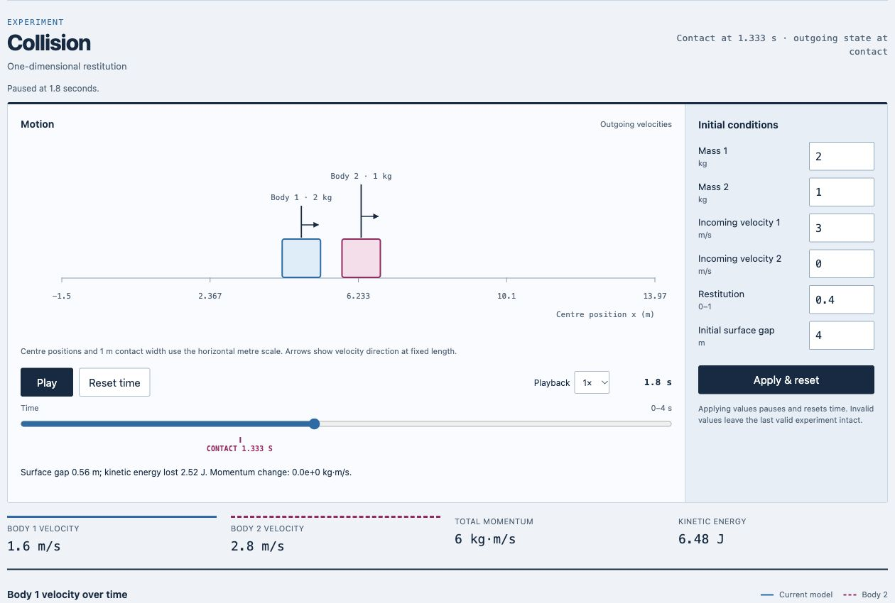
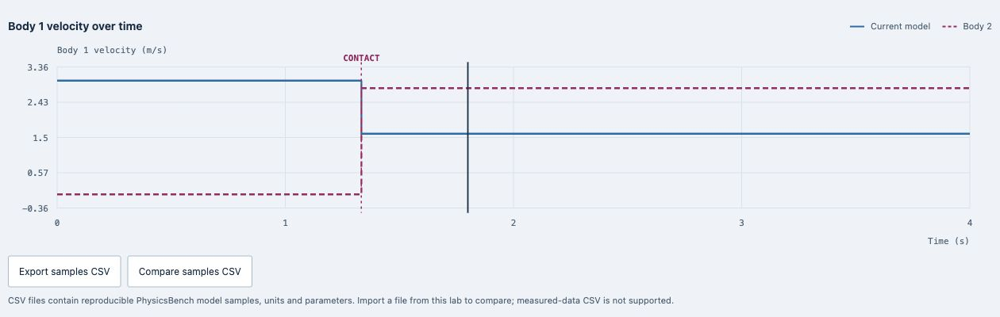

# PhysicsBench

**A mechanics bench you can pause at the instant of contact.** [Open the live instrument](https://nazeeh111.github.io/PhysicsBench/) to change initial conditions, scrub exact time, and watch the scene, measurements and plot follow the same analytical model. Sessions and sample data save as local files.

Try the collision lab: set restitution to `0.4`, select **Apply & reset**, then scrub to `1.8 s`. Contact occurs at `1.333 s`; the two bodies leave with velocities of `1.6` and `2.8 m/s`. Total momentum remains `6 kg·m/s` while kinetic energy falls from `9` to `6.48 J`.

[](https://nazeeh111.github.io/PhysicsBench/)

*Current-source browser capture of that experiment. The blue and magenta marks identify body 1 and body 2 across the scene, readings and plot.*

[](https://nazeeh111.github.io/PhysicsBench/)

*The two velocity traces change at contact. The separate cursor shows which instant the scene and measurements display.*

PhysicsBench is an original browser instrument by Nazeeh for exploring three ideal analytical mechanics models:

- **Projectile:** uniform gravity, a flat ground plane and no air resistance. The trajectory uses equal horizontal and vertical spatial scales and stops at first ground contact. Terminal readings describe the instant before impact.
- **Mass–spring:** an ideal frictionless horizontal oscillator with a linear, massless spring. Inspect four periods of displacement, velocity, force and energy exchange.
- **Collision:** two bodies in one dimension with adjustable restitution. Momentum is conserved; restitution sets kinetic-energy loss. Contact is computed analytically rather than detected from animation frames.

The interface, diagrams, code and tests are original. No oPhysics source, artwork or applets are included. These are educational idealizations, not experimentally validated predictions of real objects.

## Run locally

Use Node.js 22 or newer. There are no packages to install and no production dependencies.

```sh
npm test
npm run build
npm start
```

Open `http://127.0.0.1:4173`. To choose another local port, use `npm start -- --port 4175`. The server serves only the fixed production files from `dist/` and listens only on this computer.

The build copies the browser assets to `dist/` and records their SHA-256 hashes in `dist/manifest.json`. Deploy the contents of that directory to any static HTTP host. All application paths are relative, including JavaScript imports, so the same files work under a GitHub Pages project subpath. Direct `file://` module loading is not supported by browsers consistently. No hosting service or repository is provisioned by these commands.

## Use the instrument

Choose a lab, edit the labeled SI inputs, then select **Apply & reset**. Changes take effect together and reset time to zero. Invalid input leaves the previous experiment intact. Each lab remembers its last applied inputs until the page closes.

**Play**, **Pause**, **Reset time**, playback speed and the time slider share the same analytical state evaluator. The page starts paused and pauses when hidden. A delayed animation frame advances playback by at most 0.1 seconds before the speed factor, so a busy browser slows playback instead of making a large jump. Calculations do not depend on the frame rate. With the system's reduced-motion preference enabled, **Step** replaces continuous playback; the time slider remains available.

Native controls support keyboard operation and visible focus. Measurements and a sample table provide text alternatives to the scene and plot. Traces use solid, dashed and dotted patterns as well as color. Resizing changes only drawing geometry, not the physical state or selected time.

### Sessions and sample data

**Save session** downloads `physicsbench-session.json` with the active lab, unrounded parameters and selected time. **Open session** validates the complete file before restoring a paused experiment. Sessions are limited to 64 KiB of UTF-8 text. They use this exact versioned shape:

```json
{
  "format": "physicsbench",
  "version": 1,
  "lab": "projectile",
  "params": { "speed": 15, "angle": 45, "height": 1.5, "gravity": 9.81 },
  "time": 0
}
```

**Export samples CSV** downloads up to 201 states on an evenly spaced time grid over the complete viewing interval, including both endpoints. Times that round to the same floating-point value are emitted only once; ordinary viewing intervals retain all 201 states. A zero-duration projectile produces one state. The CSV starts with six comment lines containing JSON values for `format`, `version`, `lab`, `params`, `units` and `assumptions`, followed by the exact column names and finite numeric rows.

**Compare samples CSV** accepts this PhysicsBench model format from the active lab and overlays the primary plotted quantity as a dotted trace. Parameters may differ from the current experiment. Importing or clearing a comparison does not replace current conditions or time. This is a reproducible model replay format, not a measured-data CSV importer. Comparison parameters are listed below the plot. Collision comparison shows body 1 velocity; the dashed body 2 curve belongs to the current model.

CSV imports are limited to 512 KiB and 2,001 rows. They require matching columns, SI units and assumptions, increasing unique times within the declared model interval, and values agreeing with that model within `1e-9 + 1e-8 × |expected|`. Partial intervals are accepted. Quoted cells, formulas, arbitrary extra metadata, duplicate properties, unknown fields and unsupported versions are rejected. Failed imports retain the previous experiment and comparison. File handling uses local browser APIs; no file data is uploaded. State is kept in memory until the page closes, so save a session to keep it.

## Models and bounds

All internal quantities use SI units. Positive x points right; positive y points up. Inputs have bounded ranges to keep the instrument useful and numbers finite.

| Lab | Inputs and accepted bounds |
| --- | --- |
| Projectile | Speed 0–100 m/s; angle −90–90°; initial height 0–100 m; gravity 0.1–30 m/s² |
| Mass–spring | Mass 0.1–20 kg; stiffness 0.1–200 N/m; displacement −5–5 m; velocity −10–10 m/s |
| Collision | Each mass 0.1–20 kg; each incoming velocity −10–10 m/s; restitution 0–1; initial surface gap 0–20 m |

The projectile solves `x = v₀ cos(θ)t` and `y = h + v₀ sin(θ)t − gt²/2`. A stable quadratic root avoids cancellation for downward launches. A projectile already at ground level with no upward velocity has zero-duration flight. Mechanical energy per unit mass is `v²/2 + gy`.

The spring solves `x = x₀ cos(ωt) + (v₀/ω) sin(ωt)`, where `ω = √(k/m)`. Force is `−kx`; total energy is `mv²/2 + kx²/2`. The displayed block and spring shape are illustrative and do not model spring failure or contact.

Collision bodies have a fixed 1 m width for the contact convention; width is independent of mass. Initially their centres are `0` and `gap + 1`. If `u₁ > u₂`, contact time is `gap/(u₁ − u₂)`. Outgoing velocities solve momentum conservation together with `v₂ − v₁ = e(u₁ − u₂)`, and apply at `t ≥ contact time`. Otherwise there is no future collision. There are no walls, rotations, deformation dynamics or repeated impacts. The viewing window is 8 seconds without a future collision; otherwise it is twice the contact time, bounded to 4–20 seconds. The UI distinguishes contact beyond the window from no future contact.

The equations follow standard mechanics described in these teaching references. Source prose, exercises and illustrations are not redistributed:

- [OpenStax University Physics, Projectile Motion](https://openstax.org/books/university-physics-volume-1/pages/4-3-projectile-motion)
- [OpenStax University Physics, Simple Harmonic Motion](https://openstax.org/books/university-physics-volume-1/pages/15-1-simple-harmonic-motion)
- [OpenStax College Physics, Elastic Collisions in One Dimension](https://openstax.org/books/college-physics-2e/pages/8-4-elastic-collisions-in-one-dimension)
- [OpenStax College Physics, Inelastic Collisions in One Dimension](https://openstax.org/books/college-physics-2e/pages/8-5-inelastic-collisions-in-one-dimension)

## Verification and project structure

`npm test` runs Node's built-in test runner. Model tests use hand-computable fixtures, conservation identities, an independent acceleration-driven velocity-Verlet reference, a small Runge–Kutta reference for the oscillator with a convergence check, and a two-equation linear solver for collision velocities. These reference solvers are test-only. File-format tests cover round trips, domain boundaries, size limits, malicious or malformed values, duplicate keys and failed-import preservation. This evidence checks the specified models, not universal correctness or agreement with the physical world. Rendering and real file-picker/download interactions require a browser check separately.

- `models.js`: pure validation, analytical state evaluation and sampling.
- `data.js`: bounded session and sample formats.
- `app.js`: controls, playback and original SVG drawings.
- `index.html`, `styles.css`, `mark.svg`: accessible document, layout and original mark.
- `scripts/`: dependency-free build and local static server.

The original implementation and artwork are available under the [MIT license](LICENSE).
