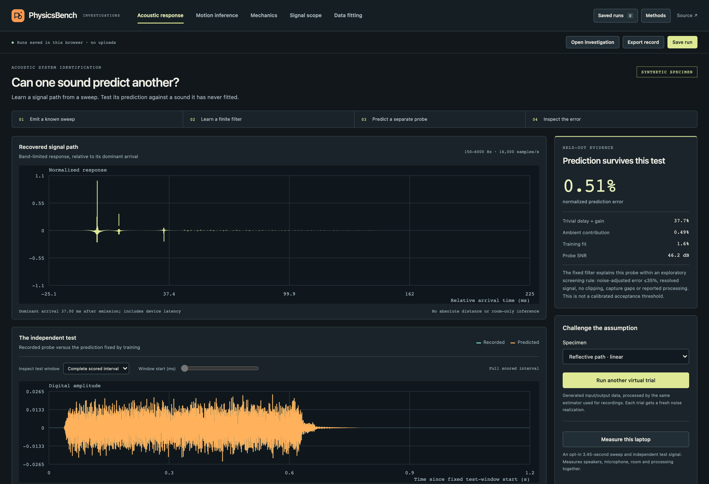
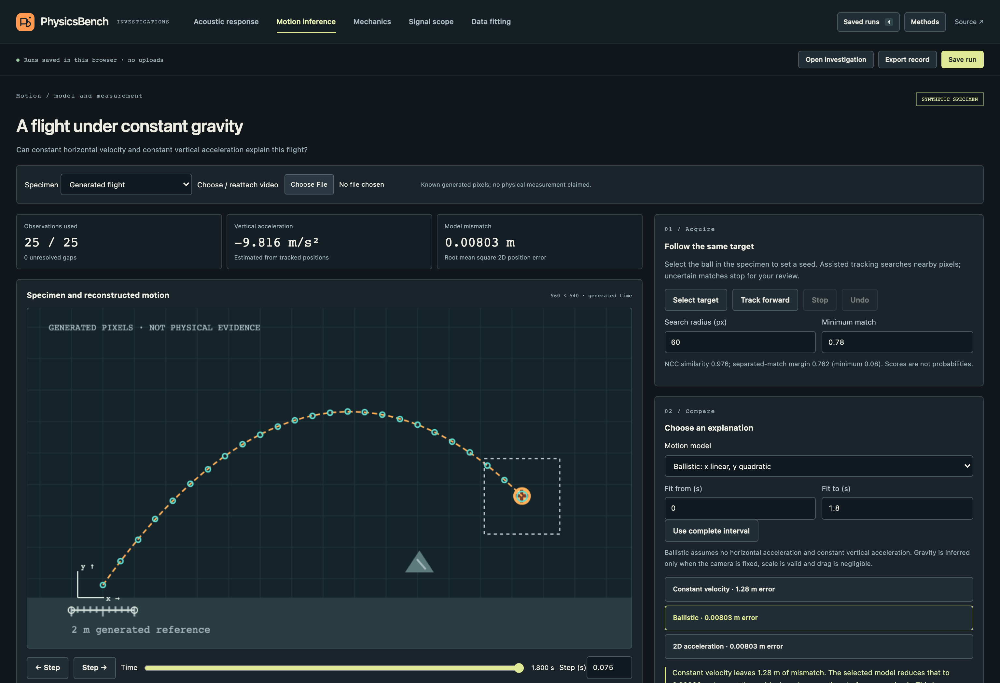
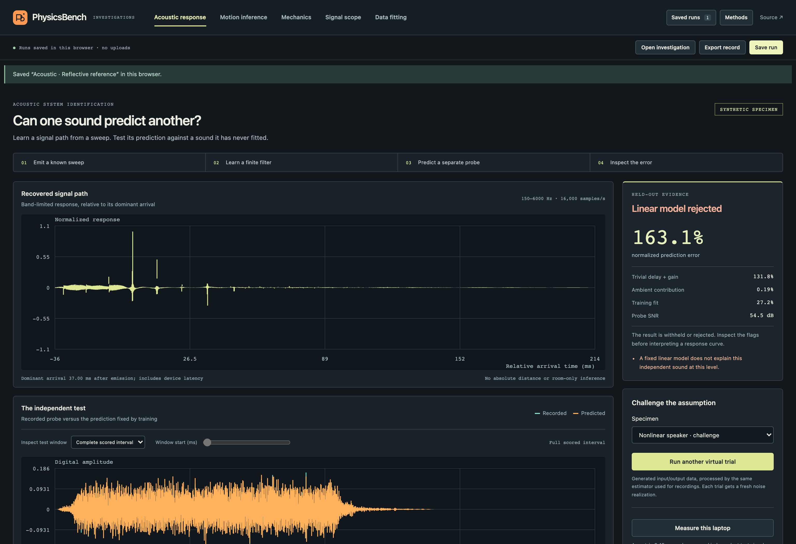
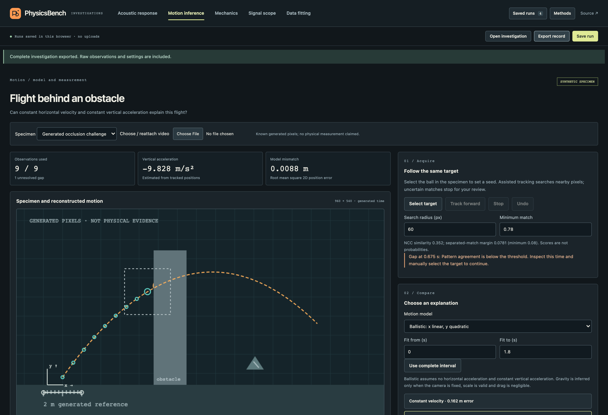

# PhysicsBench

**A model should survive a measurement it did not fit.**

PhysicsBench runs complete scientific investigations locally in the browser: recover an acoustic signal path and test it against an independent sound, or track an object from pixels and ask which motion model explains it. Raw observations, assumptions, corrections and analysis settings travel together in reopenable experiment records.

[Try the lab](https://nazeeh111.github.io/PhysicsBench/) · [Methods](docs/INVESTIGATIONS.md) · [Evidence](docs/VERIFICATION.md) · [Research and alternatives](docs/RESEARCH-V2.md)

**Review build:** these investigations are on `feat/laptop-science-workbench` in [PR #1](https://github.com/nazeeh111/PhysicsBench/pull/1). GitHub Pages follows `main` and shows the previous version until merge. Use the branch command below to run this build.



## Mechanics you can verify

The original projectile, mass–spring and collision labs remain available alongside the new investigations. For a concrete collision check, set restitution to `0.4`, select **Apply & reset**, and scrub to `1.8 s`: contact occurs at `1.333 s`, the outgoing velocities are `1.6` and `2.8 m/s`, momentum stays at `6 kg·m/s`, and kinetic energy falls from `9` to `6.48 J`.

[](https://nazeeh111.github.io/PhysicsBench/)

*Current-source browser capture of that experiment. The blue and magenta marks identify body 1 and body 2 across the scene, readings and plot.*

[](https://nazeeh111.github.io/PhysicsBench/)

*The two velocity traces change at contact. The separate cursor shows which instant the scene and measurements display.*

## Two investigations with consequences

### Can one sound predict another?

A known logarithmic sweep learns a finite, frequency-limited input/output model. A separately generated random probe tests the prediction. The probe response **never chooses the model, gain, latency or scoring window**.

- Compare the recovered filter against a simpler delay-and-gain baseline learned from the same training data.
- Inspect the impulse response, transfer magnitude, recorded/predicted probe, residuals and remaining finite-response energy. Zoom into a 5 or 20 ms detail without changing the score.
- Try a nonlinear signal path or silent probe. Clipping, unresolved signals, interrupted capture and poor held-out prediction withhold or reject the result.
- Run virtual reference trials without permissions, or explicitly record a 3.45-second speaker/microphone experiment using an AudioWorklet. The emitted stimulus and captured input share one sample timeline; real device latency remains part of the identified path.
- Save separate trials under two named conditions and compare late response energy with observed repeatability. Re-saving or relabeling identical raw samples cannot manufacture independent repetitions.

The result concerns the **combined speaker, microphone, room and processing**, at the tested band and level. It does not establish calibrated SPL, room-only response, absolute distance, RT60 or universal linearity. Imported source labels are declarations, not proof of acquisition provenance.

### Does this model explain that motion?

The opening specimen is generated image data with known truth. Observations are extracted by the **same pixel tracker** used for local video, rather than sampled directly from its trajectory equation.



- A bounded normalized-cross-correlation tracker follows a selected texture. Low similarity or competing matches stop tracking and leave an explicit gap.
- Position, residuals, selected observation and source frame share a time cursor. Correct a point, exclude it without discarding it, or undo a change.
- Compare constant velocity, ballistic motion and acceleration in both axes. Residuals expose why a more convenient assumption may be wrong.
- Calibrate ruler endpoints and origin. Change ruler/point error bounds to see acceleration sensitivity; that bound is distinct from a regression confidence interval.
- Reopen points, exclusions, model, window, calibration, settings and notes. Local video bytes stay separate; reattach the original file to inspect or correct its pixels.

**Try the occlusion specimen.** The tracker must stop at the obstacle instead of inventing observations behind it.

<details>
<summary>Failure controls, not just successful demonstrations</summary>





</details>

## An experiment record, not a screenshot

Choose **Save run** to retain an investigation in this browser across reloads. **Export record** carries raw source/response samples or image observations plus source metadata, assumptions and settings. **Open investigation** validates it and recomputes the analysis. Cached imported scores are not trusted.

Acoustic recording fingerprints are SHA-256 hashes over canonical raw float32 samples and sample rate. A/B comparison rejects duplicate captures, missing identities, failed quality checks and mismatched protocol, level, band, source, setup or reported processing. This prevents ordinary replay/label changes from becoming false replication; it does not certify physical geometry or adversarial provenance.

Browser storage has a 40-run limit with explicit removal and no silent eviction. Saves are transactional. If persistent storage is unavailable, the UI says so and export remains available. Clearing browser data removes local records. See [record formats and bounds](docs/INVESTIGATIONS.md#records-and-replay).

The original projectile, mass–spring and collision models remain in **Mechanics**, including presets, parameter studies and v1 session compatibility. **Signal scope** and **Data fitting** retain general audio and CSV utilities. Their original contracts are documented in [MECHANICS.md](docs/MECHANICS.md) and [METHODS.md](docs/METHODS.md).

## Run

Node.js 22+; no production dependencies or package installation needed:

```sh
git clone --branch feat/laptop-science-workbench --single-branch https://github.com/nazeeh111/PhysicsBench.git
cd PhysicsBench
npm test
npm run build
npm start
```

Open **http://127.0.0.1:4173**. Optional port: `npm start -- --port 4175`.

The static build uses relative URLs, an explicit asset allowlist and a SHA-256 manifest. The loopback preview verifies those bytes, blocks arbitrary filesystem access and makes no backend data requests. Host `dist/` on static HTTPS hosting; direct `file://` module loading is unsupported. No account, paid API, phone or special laptop sensor is required for the reference investigations.

## Evidence you can reproduce

`npm test` covers independent time-domain acoustic oracles, held-out response mutation, late reflections, silence, nonlinear paths, false source metadata, missing audio input, render discontinuities, tracker distractors/occlusion, numerical sensitivity, record roundtrips and the original mechanics/data invariants.

`npm run test:browser` uses a separately available Playwright installation and serves the current verified build itself. It checks actual workers and AudioWorklet execution, export/recompute, persistence, repeated comparisons, pixel tracking and gaps, corrections/undo, local MP4 timestamps, retained mechanics and narrow layouts. Hardware access is mocked or avoided. See [verification details](docs/VERIFICATION.md).

`npm run benchmark` reports cold and warmed estimator times for 16, 48 and 96 kHz on the machine running it, excluding worker/encoding overhead. It is not a claim about every laptop.

| Boundary | Current meaning |
| --- | --- |
| Reference investigations | Browser computation, generated pixels and signals. No microphone permission. |
| Real acoustic capture | HTTPS/localhost, available Web Audio/AudioWorklet/microphone, permission and explicit test-sound activation. Missing/processed/interrupted input can invalidate the experiment. |
| Local video | Supported codec, up to 200 MiB, 30 min and bounded dimensions. Presented media timestamps are used where available; unsupported automatic timing falls back to manual work rather than invented frame times. |
| Scientific evidence | Controlled digital/pixel fixtures and software checks. Real microphone accuracy, acoustic calibration and physical video validation remain unverified. |
| Portability | Standard browser APIs with graceful failure paths. Chromium is exercised by automation; Firefox/Safari and physical Windows/ChromeOS hardware need separate validation. No dedicated GPU assumption. |
| Motion error | Fits describe the selected observations; they are not held-out motion predictions. Sensitivity bounds omit timing, perspective and camera movement. |

## Why this project exists

The interesting work is connecting **source → assumptions → model → a discriminating test → a replayable record**. Browser spectra, sweep/IR measurement and video tracking already exist. [The research](docs/RESEARCH-V2.md) compares close browser precedents and stronger conventional tools, including REW, Open Sound Meter, Friture, Tracker, TrackLab and CODAP. This project does not claim to invent those techniques or outperform those tools broadly.

The implementation separates pure numerical methods, acquisition and interaction:

```text
capture-worklet.js ─ raw sample timeline ─ acquisition.js
                        │
acoustics.js ─ training-only inverse / independent test ─ acoustic-worker.js
                        │                                  │
tracking.js ─ bounded NCC ─ motion-lab.js           acoustic-lab.js
                        └──────────────┬───────────────────┘
                          experiment.js / bench.js
                 raw records · fingerprints · local storage · replay
```

Built by [Nazeeh Abdul-Hadi](https://github.com/nazeeh111). Original application code and artwork under [MIT](LICENSE). [Contributing](CONTRIBUTING.md) · [Security reporting](SECURITY.md) · [Release notes](CHANGELOG.md)
