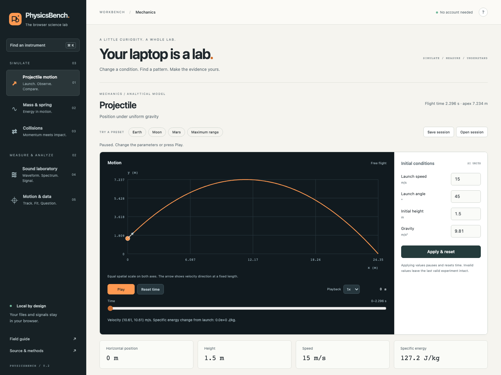
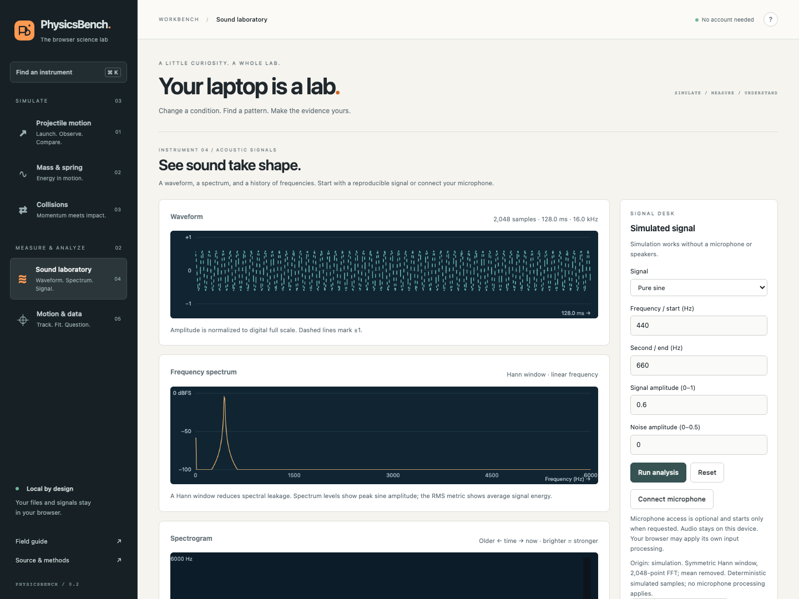
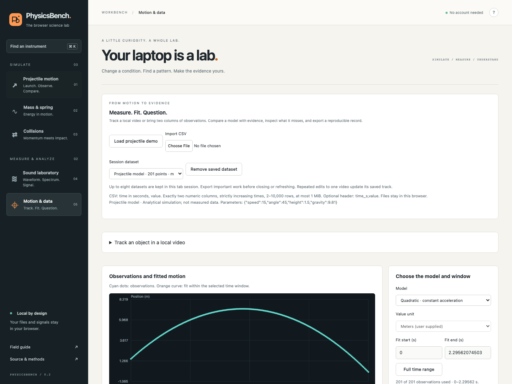

<div align="center">

# PhysicsBench

### Your laptop is a lab.

Explore a model. Inspect a signal. Make a case with data.

[Open the lab](https://nazeeh111.github.io/PhysicsBench/) · [A two-minute experiment](#a-two-minute-experiment) · [Methods](docs/METHODS.md) · [Research](docs/RESEARCH.md)

**Vanilla JavaScript · No production dependencies · Local computation · MIT**

</div>



PhysicsBench is a browser science workbench built by Nazeeh Abdul-Hadi. It connects exact mechanics simulations, optional microphone analysis and calibrated video tracking to inspectable data analysis. Files are processed locally, and the application makes no data uploads. No account, dedicated GPU, phone or paid API is needed for the simulation and demonstration workflows.

## Five instruments, one investigation

| Instrument | What you can investigate |
| --- | --- |
| **Projectile motion** | Launch conditions, Earth/Moon/Mars gravity, exact trajectories, energy and parameter sweeps. |
| **Mass & spring** | Position, velocity, restoring force, energy exchange and the square-root relationship between period and mass. |
| **Collisions** | Momentum, restitution, kinetic-energy loss and contacts that occur beyond the viewing window. |
| **Sound laboratory** | Waveform, Hann-window FFT spectrum, spectrogram, dominant frequency, relative signal level and clipping. Start with a silent synthesized signal or opt into microphone capture. |
| **Motion & data** | Track points in a local video, calibrate a reference distance, import observations, fit a line or parabola and inspect residuals and coefficient intervals. |

The useful connection is **Analyze this trajectory**: send a mechanics model directly into the same fitting tool used for local observations. Compare model choices, inspect what the residuals reveal and export the evidence. Simulation provenance remains visible, so an exact analytical curve cannot masquerade as a physical measurement.

Instrument state survives navigation within the page. Switching instruments pauses mechanics and video, releases the microphone, and stops speaker output. Measurement history retains up to eight datasets with explicit removal and no automatic eviction. Reloading or closing the page clears the session; export important work first.

## A two-minute experiment

1. Open **Projectile motion**, choose **Maximum range**, and open **Parameter explorer**. Sweep launch angle from 0° to 90°. Under equal launch/landing height and no drag, the sampled maximum appears at 45°.
2. Choose **Analyze this trajectory**. A quadratic recovers the model acceleration. Choose a linear fit and inspect its curved residuals. This demonstrates model mismatch using generated data, not a real gravity measurement.
3. Open **Sound laboratory**, choose a two-tone signal and press **Run analysis**. Inspect the two spectral peaks. The display is silent unless you explicitly start the quiet reference tone.
4. Open **Motion & data** and import [synthetic-projectile.csv](examples/synthetic-projectile.csv), or track a local video. Video values stay in source pixels until a known reference length is applied. Export observations and an analysis record.

<details>
<summary><strong>Sound and analysis screenshots</strong></summary>





</details>

## Run locally

Use **Node.js 22 or newer**. The application and numerical tests require no package installation.

```sh
git clone https://github.com/nazeeh111/PhysicsBench.git
cd PhysicsBench
npm test
npm run build
npm start
```

Open **http://127.0.0.1:4173**. For another port: `npm start -- --port 4175`.

The build creates an explicit set of static assets in `dist/` with a deterministic SHA-256 manifest. The preview verifies those bytes before serving them, binds to loopback, and refuses arbitrary filesystem paths. Rebuild and restart after editing source. Deploy `dist/` to a static HTTPS host; relative paths support GitHub Pages project subpaths. Opening ES modules directly through `file://` is not supported.

## Compatibility and scientific limits

| Capability | Requirement and boundary |
| --- | --- |
| Mechanics, synthesis, CSV analysis | A current desktop browser with JavaScript, Canvas 2D and SVG. No microphone/camera permission or special sensor required. |
| Microphone | HTTPS or localhost, Web Audio, an available microphone, and browser/OS permission. Denial or unsupported capture leaves simulation available. No microphone monitoring through speakers. |
| Sound level | RMS is **dBFS**, a digital level relative to full scale. It is **not calibrated dB SPL**. Dominant spectral frequency can be a harmonic rather than fundamental pitch. |
| Local video | Browser-decodable video, up to 200 MiB, 30 minutes, 8.3 MP, 3840 pixels per side and 8:1 aspect ratio. Tracking is manual; seeking uses the browser-reported media time and is not guaranteed frame accurate. |
| Physical video units | Known reference length in the plane of motion, fixed camera and suitable geometry. Calibration does not correct perspective, lens distortion, depth changes or camera shake. |
| Fit uncertainty | Ordinary least squares with QR decomposition, centered/scaled time and 95% coefficient intervals. Intervals assume independent normal position errors with equal variance and exact time/scale. Calibration and timing errors are excluded. |
| Portability evidence | Automated Chromium checks on macOS and Ubuntu CI across 320–1440 px widths. Windows/ChromeOS, Firefox/Safari and physical microphone accuracy runs have **not** been performed. |

Laptop accelerometers, magnetometers, barometers and force sensors are not assumed. “Laptop lab” describes a portable baseline with optional capabilities, not a guarantee about every laptop, browser or physical measurement. These are educational instruments, not calibrated metrology equipment.

Keyboard controls use native form elements and visible focus. **Ctrl/⌘ K** finds an instrument; **Escape** closes dialogs. Reduced motion replaces mechanics playback with single steps. Numeric readings, tables and exports accompany the visual plots.

## Files you can trust and inspect

- **Mechanics JSON:** versioned, bounded experiment sessions; existing v1 files remain supported.
- **Mechanics CSV:** validated model replay, with SI units and assumptions. Its strict format is separate from arbitrary measured observations.
- **Audio JSON:** a bounded exact sample-window replay, including source and acquisition information where available. It is not a continuous recording. CSV exports the same window.
- **Observation CSV:** two numeric columns, time in seconds and value; optional header `time_s,value`. Units are supplied explicitly. See the [example](examples/synthetic-projectile.csv).
- **Analysis JSON:** observations, provenance, fit window, coefficients, intervals, residuals and calibration metadata. Export-only; use the CSV and recorded settings to reconstruct an analysis. Video files themselves are not embedded.

See [methods and file limits](docs/METHODS.md) and the [original mechanics format contract](docs/MECHANICS.md).

## Engineering and evidence

The app separates pure scientific computation from browser acquisition and rendering:

```text
models.js ── analytical mechanics ── app.js ───────┐
sweep.js ─── parameter studies ───────────────────┤
audio-dsp.js ── FFT / synthesis ── audio.js ───────┼── bench.js / index.html
analysis.js ── QR regression ──── measure.js ─────┤   instrument navigation
data.js ───── bounded model interchange ─────────┘   and preserved workspaces
```

Tests cover conservation laws, independent numerical oracles, signal fixtures, regression uncertainty, file validation and distribution boundaries. Browser checks exercise actual controls, downloads and local-video calibration; microphone lifecycle checks use simulated hardware. **Actual microphone accuracy and cross-device scientific validation are untested.** Exact passed checks and reproduction commands are in [VERIFICATION.md](docs/VERIFICATION.md).

Research considered twelve relevant precedents, including phyphox, PhET, Tracker, CircuitJS, CODAP, JupyterLite and Chrome Music Lab. [The research record](docs/RESEARCH.md) explains what transfers and what does not. The interface, analytical implementation and illustrations are original; no third-party app artwork or applets are redistributed. Combining established techniques is not a claim of scientific novelty or a measured tenfold improvement.

## Project and contribution

Issues and focused pull requests are welcome. Include the input data, browser/version, expected behavior and reproducible steps. See [CONTRIBUTING.md](CONTRIBUTING.md), [security reporting](SECURITY.md) and [release notes](CHANGELOG.md).

Built by **[Nazeeh Abdul-Hadi](https://github.com/nazeeh111)**. [MIT license](LICENSE).
